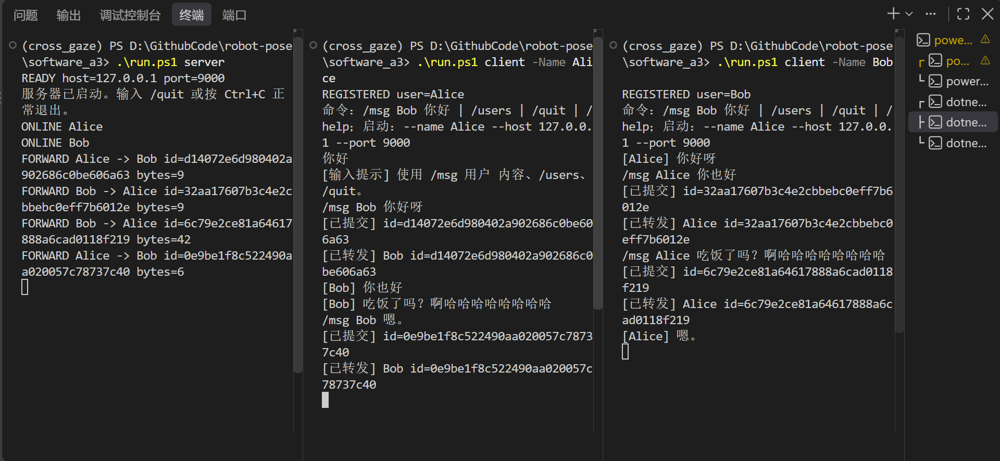

# 机器人应用实践题

按每题一个独立项目存放。各题都有自己的入口、实现模块、测试、结果目录和调试配置。

总目录为 `D:\GithubCode\robot-pose`：

| 题目 | 独立目录 | 运行入口 | 推导与调试说明 | 实际结果 |
| --- | --- | --- | --- | --- |
| 机器人 B1 | `robot1` | [main.py](robot1/main.py) | [第一题 README](robot1/README.md) | [文本结果](robot1/output/robot1.txt) |
| 机器人 B2 | `robot2` | [main.py](robot2/main.py) | [第二题 README](robot2/README.md) | [文本结果](robot2/output/robot2.txt) |
| 机器人 B3 | `robot3` | [main.py](robot3/main.py) | [第三题 README](robot3/README.md) | [文本结果](robot3/output/robot3.txt) |
| 软件 A1 | `software_a1` | [server.py](software_a1/server.py) + [controller.py](software_a1/controller.py) | [文件作用、运行与调试](software_a1/README.md) | [实际执行记录](software_a1/output/last_run.json)、[演示视频](software_a1/output/process.mp4) |
| 软件 A3 | `software_a3` | [C# 服务器](software_a3/src/Chat.Server/Program.cs) + [C# 客户端](software_a3/src/Chat.Client/Program.cs) | [协议、文件作用、运行与调试](software_a3/README.md) | [自动测试](software_a3/output/test-results.txt)、[实际聊天记录](software_a3/output/process-demo.txt)、[运行示例截图](software_a3/output/example.png) |

三道机器人题的模块、类、函数和结果文件统一使用 `robot` / `Robot` 命名。三题结果及软件 A1 的 JSON 报告使用 `robot` 字段标识题目，题号值保留 `B1`、`B2`、`B3`、`A1`。

## 软件 A1：三维场景与外部驱动

在独立目录运行服务，使用浏览器打开页面，再在另一个终端启动控制脚本：

```powershell
Set-Location 'D:\GithubCode\robot-pose\software_a1'
.\.venv\Scripts\python.exe server.py
```

浏览器打开 `http://127.0.0.1:8000/`；第二个终端进入相同目录运行：

```powershell
.\.venv\Scripts\python.exe controller.py
```

首次安装、路径配置、各个代码文件的重要内容，以及测试和调试见 [A1 说明](software_a1/README.md)。本题使用自己的 `.venv` 和 `output`，Three.js 资源保存在本地。

运行演示：[观看 process.mp4 视频](software_a1/output/process.mp4)。

## 调试与依赖

用 VS Code 打开整个 `D:\GithubCode\robot-pose`，根目录的 `.vscode/launch.json` 提供十三个配置：

- A3：调试 C# 服务器、Alice 客户端、Bob 客户端、自动测试（四个配置）。

- A1：启动三维服务。
- A1：调试外部控制脚本。
- A1：运行 Python 测试。

- 第1题：调试计算过程。
- 第2题：调试正解与下料。
- 第3题：调试视觉定位与抓取。
- 第1题：运行全部单元测试。
- 第2题：运行全部单元测试。
- 第3题：运行全部单元测试。

各配置指定了对应题目的入口和工作目录。也可以只打开某一题的文件夹，使用该题自身的 `.vscode/launch.json`。

机器人 B1 / B2 / B3 的主程序需要 Python 3.10 或以上，只依赖标准库；可选 SciPy 用于外部验证。软件 A1 的服务需要安装其 `requirements.txt`，使用独立虚拟环境。

已验证环境为 Python 3.12.4、SciPy 1.13.1：第一题 29 项、第二题 37 项、第三题 49 项测试全部通过，均包含外部交叉验证。

软件 A1：21 项 Python 测试、17 项 JavaScript 测试通过，并完成真实 Chrome + 独立外部控制程序的端到端验收。实际输出与截图保存在 `software_a1/output`。

## 软件 A3：C# 多客户端 TCP 聊天

独立项目及其本地 .NET 10 SDK 位于 `software_a3`。先编译和测试：

```powershell
Set-Location 'D:\GithubCode\robot-pose\software_a3'
.\run.ps1 build
.\run.ps1 test
```

再打开三个终端，分别在同一目录执行：

```powershell
.\run.ps1 server
.\run.ps1 client -Name Alice
.\run.ps1 client -Name Bob
```

上述三行分别在三个终端运行，不是在一个终端依次执行。Alice 中输入 `/msg Bob 你好`，Bob 中输入 `/msg Alice 收到`，`/users` 查询在线用户，`/quit` 退出。

完整的首次安装、协议设计、每个文件的重要内容和调试步骤见 [A3 说明](software_a3/README.md)。26 项测试覆盖分包、连续帧、多客户端并发、异常连接及真实控制台进程的聊天和退出。测试与聊天记录保存在 `software_a3/output`。

运行示例截图：



## 机器人B1：已知工件位姿和夹爪安装关系，反求法兰位姿。

```powershell
cd D:\GithubCode\robot-pose\robot1
python main.py
```

结果保存在 `robot1/output/robot1.txt` 和 `robot1/output/robot1.json`。

## 机器人B2：已知法兰位姿和安装链，求 TCP、工件位姿，合并固定链，恢复当前法兰，并反求下料法兰目标。

```powershell
cd D:\GithubCode\robot-pose\robot2
python main.py
```

结果保存在 `robot2/output/robot2.txt` 和 `robot2/output/robot2.json`。

## 机器人B3：已知工件位姿、抓取法兰、抓取目标、视觉定位、视觉回代、视觉抓取、视觉下料，求抓取目标、下料目标。

```powershell
Set-Location 'D:\GithubCode\robot-pose\robot3'
python main.py
python -m unittest discover -s tests -v
```

结果保存在 `robot3/output/robot3.txt` 和 `robot3/output/robot3.json`。

## 从总目录直接运行

此处三个计算入口对应机器人 B1 / B2 / B3：

```powershell
cd D:\GithubCode\robot-pose
python .\robot1\main.py
python .\robot2\main.py
python .\robot3\main.py
```

默认输出目录按各自 `main.py` 的实际位置确定，与终端当前目录无关。三题使用不同结果文件名，输出不会相互覆盖。

