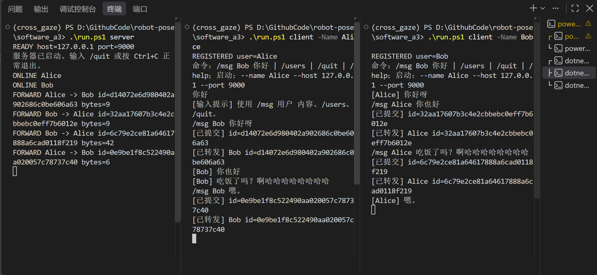

# 软件应用 A3：C# 多客户端 TCP 聊天

本题独立存放在 `D:\GithubCode\robot-pose\software_a3`，与软件 A1、机器人 B1/B2/B3 分开运行、测试和保存结果。

实现形式为一个控制台服务器、可同时打开多个的控制台客户端。Alice 发给 Bob 的消息先到服务器，由服务器查找 Bob 的连接并转发；Bob 可以回复 Alice。使用 C#、TCP、异步收发和自定义长度协议，只依赖 .NET 标准库。

## 先运行起来

当前电脑已经安装好**本项目专用 .NET SDK 10.0.404**，放在 `software_a3\.dotnet`。运行脚本直接使用该 SDK，不需要修改系统 PATH，也不使用系统中原有的 .NET 9。

在 PowerShell 中先编译、测试：

```powershell
Set-Location 'D:\GithubCode\robot-pose\software_a3'
.\run.ps1 build
.\run.ps1 test
```

之后打开三个独立终端，每个终端都先进入上述目录。

终端一，启动服务器，保持运行：

```powershell
.\run.ps1 server
```

看到 `READY host=127.0.0.1 port=9000` 表示已开始监听。

终端二，启动 Alice：

```powershell
.\run.ps1 client -Name Alice
```

终端三，启动 Bob：

```powershell
.\run.ps1 client -Name Bob
```

两个客户端均显示 `REGISTERED` 后，在 Alice 的终端直接输入：

```text
/msg Bob 你好，我是 Alice 🙂
/users
```

Bob 会看到 `[Alice] 你好，我是 Alice 🙂`。在 Bob 的终端输入：

```text
/msg Alice 收到，我是 Bob
```

可在第四个终端运行 `.\run.ps1 client -Name Carol` 验证第三个客户端。每个客户端输入 `/quit` 退出；服务器输入 `/quit` 或按 Ctrl+C 关服，客户端会结束网络接收并退出。

命令行里不要输入示例代码块中的 ``` 标记。聊天命令是在客户端启动后输入，不能在 PowerShell 提示符下直接输入 `/msg`。

## 运行环境与首次安装

| 项目 | 要求 |
| --- | --- |
| 操作系统 | Windows；安装脚本支持 x64 / Arm64，当前项目在 Windows 上验证 |
| .NET | .NET **10 SDK**，项目固定到 10.0.404，允许同一功能版本的补丁更新 |
| 终端 | Windows PowerShell 5.1 或 PowerShell 7 |
| 编辑器 | 运行无需 IDE；断点调试可用 VS Code 和 Microsoft C# 扩展 |
| 第三方库 | 无；不需要 Python 虚拟环境、不需要在线 NuGet 包 |

如果复制到另一台电脑，没有 `.dotnet` 目录，执行一次：

```powershell
.\run.ps1 setup
.\run.ps1 build
.\run.ps1 test
```

`setup` 需要联网，从微软官方发布信息取得 SDK 下载地址，校验 SHA-512 后解压到项目目录。系统 HTTPS 下载不可用时，会尝试调用已有 Python 的 HTTPS 下载；Python 只用于这一安装回退，不参与 C# 聊天程序的运行。安装完成后，本地编译、运行和测试无需联网。

如果终端提示“禁止运行脚本”，可用以下方式只放行本次启动，不修改电脑长期策略：

```powershell
powershell -NoProfile -ExecutionPolicy Bypass -File .\run.ps1 build
powershell -NoProfile -ExecutionPolicy Bypass -File .\run.ps1 server
powershell -NoProfile -ExecutionPolicy Bypass -File .\run.ps1 client -Name Alice
```

服务器和客户端仍分别在独立终端运行。

查看本项目 SDK：

```powershell
.\.dotnet\dotnet.exe --info
```

SDK 负责把 `.cs` 源码编译成 `.dll`，同时附带运行这些程序所需的运行时。`run.ps1` 是命令入口，**C# 源码位于 `src` 目录**。

## 文件和关键内容

| 文件 | 作用及重要内容 |
| --- | --- |
| `src/Chat.Protocol/ChatMessage.cs` | 定义消息类型、六个消息字段、消息工厂、用户名及 UTF-8 内容长度校验。服务器名 `server` 保留；用户名大小写不区分。 |
| `src/Chat.Protocol/FrameCodec.cs` | 编码和读取一帧。4 字节大端帧头声明 JSON 字节数；循环读足帧头及帧体；处理半包、连续多帧、截断、非法长度与 JSON。 |
| `src/Chat.Protocol/FramedConnection.cs` | 管理一条连接；`SemaphoreSlim` 让整个帧依次写入；只允许一个接收循环。帧写到一半失败或读取被取消时关闭连接，防止下一帧错位。 |
| `src/Chat.Server/ClientSession.cs` | 保存用户和连接；注册确认发送完成后才允许转发聊天，避免客户端尚未注册完成便收到聊天帧。 |
| `src/Chat.Server/ChatServer.cs` | 接受多个连接、注册、在线连接表、定向转发、在线用户查询、退出清理和超时。发送方必须与当前连接注册身份一致。 |
| `src/Chat.Server/Program.cs` | 服务器入口；解析地址和端口，打印状态，处理 `/quit` 与 Ctrl+C。 |
| `src/Chat.Client/ChatClient.cs` | 客户端网络逻辑；连接和注册、发送聊天、查询用户、接收校验、主动退出。界面代码不直接拼接网络字节。 |
| `src/Chat.Client/Program.cs` | 客户端入口和控制台交互；解析 `/msg`、`/users`、`/help`、`/quit`；输入与接收并行，关服时不被键盘输入阻塞。 |
| `tests/Chat.Tests/ProtocolTests.cs` | 测试中文字节数、分包、连续帧、非法长度、截断、并发写入和取消行为。 |
| `tests/Chat.Tests/NetworkTests.cs` | 通过真实本地 TCP 测试双向聊天、多发送方、重名、冒用发送方、离线、异常连接隔离及清理。 |
| `tests/Chat.Tests/ProcessTests.cs` | 启动真实服务器和多个客户端进程，经标准输入发送命令，检查实际输出与退出，保存完整演示记录。 |
| `tests/Chat.Tests/TestSupport.cs` | 断言和模拟数据流，强制每次只读几个字节，检查同一连接是否出现重叠写入。 |
| `tests/Chat.Tests/Program.cs` | 自带测试入口；筛选测试、统计通过数、生成 JSON / 文本报告、返回退出码。 |
| `run.ps1` | 统一入口：安装、编译、启动服务器 / 客户端、运行测试。使用项目本地 SDK 和缓存。 |
| `tools/setup-sdk.ps1` | 下载、校验、检查归档路径并安装本地 SDK。 |
| `ChatDemo.sln` | 解决方案入口，统一组织三个业务项目及一个测试项目。 |
| 各目录的 `*.csproj` | 项目配置与引用关系；服务器、客户端共用协议，测试引用这三个项目。 |
| `Directory.Build.props` | 统一目标框架 `net10.0`、可空检查、把编译警告作为错误处理。 |
| `global.json` | 指定编译所用的 SDK 版本。 |
| `NuGet.Config` | 清空在线包源；此项目没有第三方包依赖。 |
| `.vscode/launch.json`、`tasks.json` | 服务器、Alice、Bob、测试的调试启动项与编译任务。 |
| `.gitignore` | 忽略 SDK、缓存和 `bin/obj` 等生成目录。 |

推荐阅读顺序：`ChatMessage.cs → FrameCodec.cs → FramedConnection.cs → ChatServer.cs → ChatClient.cs → 两个 Program.cs`。

## 自定义协议：为什么不会把消息混在一起

TCP 提供有序的**字节流**，一次发送不能对应为接收方一次读取。本程序按如下规则找消息边界：

```text
一帧 = [4 字节帧体长度 N，网络字节序 / 大端] [N 字节 UTF-8 JSON]
后面紧接下一帧。
```

聊天消息的 JSON 示例：

```json
{
  "type": "chat",
  "sender": "Alice",
  "receiver": "Bob",
  "contentLength": 6,
  "content": "你好",
  "messageId": "example-001"
}
```

| 字段 | 含义 |
| --- | --- |
| `type` | `register` / `register_ok` / `chat` / `forwarded` / `users_request` / `users` / `error` / `quit` |
| `sender` | 发送方用户名；服务器发送的控制消息用 `server` |
| `receiver` | 接收方用户名；注册、查询和退出操作发给 `server` |
| `contentLength` | **解码后的聊天内容按 UTF-8 编码所占字节数**；“你好”为 6，不是 C# 字符串的长度 2 |
| `content` | 实际内容，支持中文、空格和表情 |
| `messageId` | 关联聊天、转发反馈和错误反馈的编号 |

外层帧头的 `N` 是**整个 JSON 的 UTF-8 字节数**，包含字段名和其他字段；与内层 `contentLength` 含义不同。发送方先序列化 JSON 再计算 N，接收方先读足 4 字节取得 N，验证上限，再恰好读取 N 字节并解析。无需人工计算 N。

`FrameCodec.ReadAsync` 先读一部分帧头，再用 `ReadExactlyAsync` 读足余下部分和帧体。一次只到一个字节也能拼出一帧；两帧同时到达时，本次只消费第一帧的字节，下一次调用继续读取第二帧。两帧之间关闭返回 `null`；帧头或帧体中途关闭报协议截断错误。

单帧 JSON 上限 64 KiB、内容上限 16 KiB，两个限制同时生效。JSON 对控制字符的转义可能使帧体变长。必需字段缺失、未知字段 / 类型、地址格式错误或内容长度不符会拒绝。

服务器使用注册连接决定真实发送身份。它将用户名映射到连接，同一接收方有多个消息来源时，通过同一把发送锁依次写入完整帧。`NoDelay` 仅影响交互延迟，消息边界仍由长度协议保证。

`[已提交]` 表示客户端完成本次发送；`[已转发]` 表示服务器已完成向接收方连接的写入。它不是对方已阅读的回执，本题没有实现持久化、离线消息或阅读确认。

## 测试与结果

```powershell
.\run.ps1 test
.\run.ps1 test -Filter protocol
.\run.ps1 test -Filter network
.\run.ps1 test -Filter process
```

`test` 会先编译再执行自带验收程序；**请使用上述命令，不是 `dotnet test`**，本项目未引入外部测试框架。

完整测试共 26 项。包含 60 次同连接并发发送、Alice 与 Carol 同时向 Bob 发送 80 条消息，以及真实控制台进程的聊天与退出测试。测试使用自动分配的本地端口，不占用手动演示的 9000。

输出均位于本题 `output`：

- `test-results.txt`、`test-results.json`：最近一次完整测试的实际结果。
- `test-results-filtered.*`：筛选运行的结果，不覆盖完整报告。
- `process-demo.txt`：真实服务器 / 客户端进程的输入和输出，不是手工编写的示例。
- [example.png](output/example.png)：多客户端聊天运行示例截图。



完整运行应显示 `总计 26，通过 26，失败 0`。退出码 0 表示成功，1 表示测试 / 运行失败，测试命令参数错误返回 2。

## 怎么调试

最直接的方法是先正常启动服务器，然后在另两个终端运行客户端，观察服务器的 `ONLINE`、`FORWARD`、`OFFLINE`，以及客户端对应消息编号。

需要逐行观察时，用 VS Code 打开本题文件夹或总项目文件夹，安装 Microsoft 的 **C# 扩展**（`ms-dotnettools.csharp`），在“运行和调试”中选择 A3 对应配置：

1. 先运行一次 `.\run.ps1 setup`（当前机器已完成）。
2. 选“A3：调试服务器”，按 F5，等到 `READY`。
3. 保持服务器运行，再启动 Alice、Bob 配置，或在其他终端用命令启动客户端。
4. 在 `ChatServer.ForwardAsync` 下断点，用 Alice 发给 Bob，检查 `message`、`sender.UserName`、`recipient.UserName`。
5. 在 `FrameCodec.ReadAsync` 检查 `length` 与 `message.ContentLength`；在 `FramedConnection.SendAsync` 观察写入前的完整 `frame`。

配置使用集成终端接收聊天输入。调试单独测试时，选择“A3：调试自动测试”，也可临时添加 `--filter protocol` 到参数中。

断点暂停会影响 10 秒注册超时 / 5 秒发送超时。初学时优先在注册完成后对转发逻辑下断点；若需长时间观察超时内的路径，可临时增加 `ChatServer` 构造函数的超时参数，调试后恢复。

此处已验证命令行构建和真实控制台进程；VS Code 的图形界面断点调试需要本机安装对应扩展后使用。

## 常见问题

| 现象 | 处理 |
| --- | --- |
| 连接被拒绝 | 先启动服务器并确认 `READY`；客户端地址、端口要一致。 |
| 端口被占用 | 关闭之前启动的服务器，或运行 `.\run.ps1 server -Port 9100`；所有客户端都追加 `-Port 9100`。 |
| 用户名已在线 | 每个实例使用不同名字；Alice 和 ALICE 被视为同名。用户名限 1–20 位字母 / 数字 / 下划线，首位是字母，`server` 保留。 |
| `recipient_offline` | 对方先启动并显示注册成功，检查收件人拼写。 |
| 修改代码后运行行为没变 | 先退出旧程序，重新 `.\run.ps1 build` 再启动。`server/client` 操作不隐式编译。 |
| 全局 `dotnet` 显示 9.0 | 本题使用本地 SDK；通过 `run.ps1` 运行即可。 |
| 中文显示异常 | 用支持 UTF-8 的终端及中文字体；程序已设置 UTF-8 输入和输出。 |

默认使用 `127.0.0.1:9000`，便于同一台电脑演示。如果确需跨电脑运行，服务器可用 `-HostName 0.0.0.0` 监听，客户端使用 `-HostName 服务器的局域网IP`，并允许相应端口通过防火墙。

提交时保留源码、项目配置、脚本、本文和 `output` 结果。`.dotnet` 是体积较大的 SDK，不必随源码提交；`bin`、`obj`、缓存也可以排除，接收方先安装 SDK 再编译。

## 官方参考

- [TCP 客户端与服务器](https://learn.microsoft.com/en-us/dotnet/fundamentals/networking/sockets/tcp-classes)：理解本程序的 `TcpListener`、`TcpClient` 和 `NetworkStream`。
- [Stream.ReadExactlyAsync](https://learn.microsoft.com/en-us/dotnet/api/system.io.stream.readexactlyasync?view=net-10.0)：指定长度读取及读取不完整时的异常。
- [.NET SDK 与运行时安装](https://learn.microsoft.com/en-us/dotnet/core/install/windows)：运行时负责执行，SDK 还负责编译。
- [VS Code C# 调试配置](https://code.visualstudio.com/docs/csharp/debugger-settings)：启动参数、环境变量、终端与断点相关配置。
